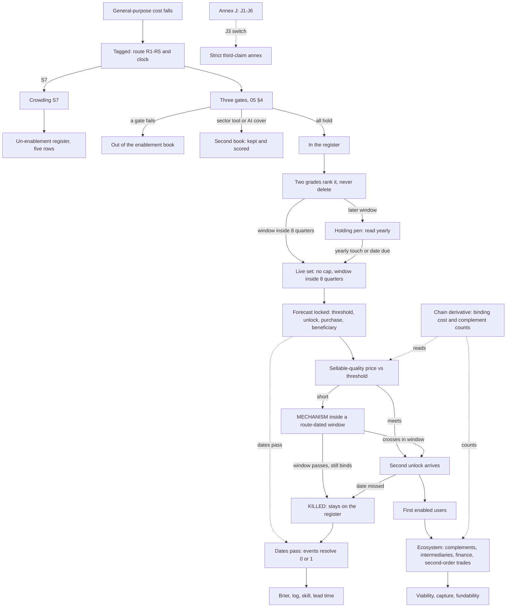

# Mission logic map

*v1.1 · 16 Oct 2026; cap and cadence text brought into line with 05 v1.4 on 16 Nov 2026 · companion to 05_Mission_Statement.md (written against v1.1, now v1.4). Grok draft (D6), Claude-checked; flow redrawn by Claude so the gates come before the price test.*

This map traces one chain through 05 v1.0, from a fallen cost to a score, a kill, or the un-enablement register. It records the historic rule each step rests on, and the places where 05, 01, 03 and the rung-5 rulings disagree.

## The chain, as a flow

1. A general-purpose cost falls and is tagged with route R1–R5 and a clock (05 §3.2, §4, §5.1). Crowding (S7) branches to the un-enablement register: five rows, one indicator each (05 §3.5, §3.8, §7.3).
2. The three gates decide admission before any price test. A row is out, goes to the second book (kept and scored, not delivered; the project owner, 16 Oct 2026), or enters the register (05 §4, §9.1).
3. The two grades rank an admitted row and never delete it (05 §4).
4. A chain whose window falls inside eight quarters is live, up to 12. Other chains go to the holding pen, read once a year, or earlier when a complement date falls due (05 §7.1, §7.5).
5. A live chain gets its locked forecast. The first wave is locked by 31 Jan 2027 (05 §7.6, §9.4, decided 16 Oct 2026).
6. The sellable-quality price is compared with the threshold. If it is short, the chain is MECHANISM inside a route-dated window (05 §3.1, §6).
7. If the window passes and the constraint still binds, or the second unlock misses its date, the chain is KILLED. It stays on the register and is not re-read (05 §3.1, §6).
8. When the second unlock arrives, the first enabled users appear. The ecosystem field names the scarce complement and the second-order trades. Five chains keep the full nine layers (05 §3.3, §3.4, §6, §7.2).
9. Viability, capture and fundability are three lines (05 §3.7, §3.7a).
10. The chain derivative reads the binding cost and the complement counts. Annex J (J1–J6) reads only the strict third claim, with J3 as the switch. A J verdict is never copied onto a chain (05 §3.2a; 01 §5, §6.4).
11. As dates pass, the locked events resolve to 0 or 1, killed chains included, and are scored (05 §7.6).

## The admission logic

All three gates must hold. A grade never deletes a row.

| Step | Question | If yes | If no | Source in 05 |
|---|---|---|---|---|
| Gate 1 | Is the output free of AI advice, a decision, tuition, a warning, or AI-authored content? | Continue. Rendering a human-authored work does not fail this gate, and it is not, by itself, a result. | Out of the enablement book. | §4. Synthetic performance is open in §9.2. |
| Gate 2 | Is it a new output that could not pay at the old cost, including a service cheap enough for broader adoption by buyers who could not afford it before? | Continue. | Out. An existing firm serving its existing customers the same output more cheaply is diffusion, reported in the capture book. | §4, §5.9 |
| Gate 3 | Is the customer buying something other than AI? | Continue. An AI-native seller must name the customer and what that customer buys. | If the customer is buying AI, out. If the buyer is unnamed, the row is incomplete, not evidenced. | §4 |
| AI supply chain | Is the row chips, cloud, data centres, their builders, or an AI lab? | Out. Any enabled business is the named customer of an AI-native seller. | Continue. | §4 |
| Second book | Is it a sector-specific tool in the firm's own production, or cover for AI systems themselves? | Kept, tagged and scored, not delivered, unless the project owner says so. | It is not sent to the second book. | §3.4, §4, §7, §9.1 |
| Grade: cost share | Is the cheapened input a large share of unit cost, in continuous or bulk use, at a low value per unit? | The row ranks higher. | The row stays. A small line item is diffusion in the capture book. | §4, §5.12; 01 §4 L3 |
| Grade: nine layers | Is the full nine-layer map filled? | The chain can be one of the five maps. | The chain stays. It cannot be one of the five maps. | §4, §7.2 |
| Count toward the 15 | Are the scarce complement, the second-order trades, and the second unlock filled? | The chain can count toward the 15. | It does not count toward the 15. | §6, §7.1 |
| Live set or holding pen | Is the crossing window inside the next eight quarters, with a sellable-quality price, a date and a conjunction? There is no cap on the live set (the project owner, 16 Oct 2026). | Live set. | Holding pen, touched once a year. | §7.1, §7.5 |
| Argon lead | Has a person or a second auditor opened the cited page, and does the lead have a sellable-quality price, a date and a conjunction? | It may enter the live set; no cap applies. | It stays in the holding pen. A page is not a result. On the audited return, 1 of 28 cases was fully supported, 16 of 28 were direct users, and 8 of 28 were inside or beside the supply chain. | §5.15, §7.1, §8 |

## Traceability

| Clause | Rests on | Evidence named in 05 or 01 | What would falsify it | Where it is measured |
|---|---|---|---|---|
| Object | 01 L1, L14. 05 §5.1, §5.6, §5.9. L3 is a grade, §5.12, not this gate. | US transit about $1,200 per Mbps in 1998 to about $25 per Mbps in 2007; Netflix "Watch Now" on 16 Jan 2007. V1, claim 12, PARTLY (05 §2). 03 dates streaming to January 2007. | The customer is buying the AI, or an existing firm is using AI to do its existing job better (05 §1). | Enabled party; the three gates; Status. |
| Ecosystem | 01 L5, L13, L14, L17. 05 §5.3, §5.6, §5.17. | Horse stock from just over 1 million in 1811 to more than 3 million in 1901. National Army Museum, undated page. V1, claim 3, PARTLY (05 §3.4). | Specialist intermediaries for a task stay flat for eight quarters after successive vintages pass sellable quality (05 §3.9). | Ecosystem field, layers 3 and 9; five nine-layer maps; complement counts. |
| Timing | 01 L11. 05 §5.2, §3.1. | Epoch, 22 Sep 2026: about 75×, about 13× and about 4.7× a year, on three of five benchmarks (05 §3.2). Electricity's boost about 40 years after the first commercial stations. Crafts, May 2003. V1, claim 2, CONFIRMED (05 §3.1). Fibre lag 1–5 years (03 §1; 03 §10, E01). | One lag dates every chain, or a chain that waits on a plant, a statute, a standard or a critical mass is dated from the calendar (05 §3.1, §5.2). | Window field; route-dated kill; dashboard clocks. |
| Method | 01 L1, L16. 05 §5.1, §5.7, §5.8, §5.13. | Across K02, K04, K06, K07 and K08, a second factor binds. K parcels, 16 Oct 2026 (05 §3.3). | A delivered chain lacks the fallen cost, the threshold, the second unlock, the ecosystem, the capturer, the funder, or a dated signal (05 §1, §6). | The §6 fields. Open is allowed only on a trigger reading or a review date. |
| Signal | 05 §3.2a. The J-readings in 05 §5.14 are the other family. | Epoch, 22 Sep 2026, same three rates, three of five benchmarks. Benchmark cost is not sellable-quality cost (05 §3.2a). | Lead time is zero: a public source names the beneficiary with no earlier locked probability above 0.7 (05 §7.6). | Triggers; trailing four-quarter log changes; lead time. |
| Reverse | 01 L15, L7. 05 §5.5, §5.10. | DDR4 8Gb chip $1.50 in Oct 2023 to $25 in late Aug 2026. Transformers +77% since 2019. Fibre +70% from the 2021 trough (01 §4 L15; 03 §5). Step-up units above 160 weeks in Q1 2026 (05 §7.3). | The five classes in 05 §3.8 are not dearer on those indicators. A glut in the builders' own market is a separate, pre-registered restoration reading (05 §3.2, §3.8). | Un-enablement register, five rows. Housing has no indicator (05 §7.3). |
| Discipline | No L-rule. 05 §5.13, §6, §7.6. | The scoring rule is prospective. V1, 16 Oct 2026, re-checked 12 claims: 7 confirmed, 5 partly confirmed, 0 refuted (05 header). That score is about those claims. | A locked line is edited, a bare 0.5 is used as the reference, or evidence deletes a class the project owner did not rule out (05 §6, §7.6). | Brier, shown; log score; skill; calibration by bin; lead time. |
| Test | 05 §5.9, §5.16, §5.20. 01 L14 for the content tail. | Uber fails: the measured gain was Uber's own matching (03 §2; 05 §3.3). eBay 2014, +10.9%, was a quality step on a layer that was already free (03 §1, §3; 05 §5.16). | A delivered row is a customer buying AI, or an existing firm doing its existing job better (05 §1). | The three gates; three outputs in §7.7; composition test (c) in §7.1. |

## History, lesson, mission rule

| L-rule | Historic episodes it came from | One-line lesson | Where 05 v1.0 uses it | Gate, grade, tag, signal, or not used |
|---|---|---|---|---|
| L1 | R1: fibre, Cleveland refineries, Hendee, Core Scientific. R2: UK railways, US railroads, rubber estates, canal premiums. R3: steamships, bicycles, DRAM, cells, GPUs, tokens. R4: UK press rate, 1844 penny train, Niagara, Bonneville; Stevenson cartel as the reverse. R5: radio daytime, naphtha, ethane. R0: Insull. | The way the input got cheap decides what forms, and only some routes create third claims. | §5.1, §3.1, §4, §3.9 | Tag |
| L2 | Passenger railway; carriers' wholesale capacity; lamp oil; evening sponsors; carmakers' cells; utility-scale solar; an import terminal. | A strict third claim sells to a customer the builders' prospectus never priced. | not used in 05 | not used |
| L3 | Milk by the gallon; two hours a day of 1 Mbps video; an offshore voice trunk; ethane as cracker feedstock; smelting. Diffusion examples: SaaS, Indian software exports, Skype, high-value oranges and reapers. | Cheapness matters when the input is a large share of unit cost, use is continuous or bulk, and value per unit is low. | §4, §5.12 | Grade |
| L4 | Milk, dressed beef, frozen mutton, bananas, news, cotton prices, storm warnings. | The scarce piece is the cold chain or the time-critical network, not the cheap haul. | §5.18 | Tag |
| L5 | Cogent, Level 3, Netflix, YouTube, Swift, Vestey, Alcoa, Cheniere, CoreWeave. | Value goes to the scarce complement. Operators of the cheap asset earn utility returns. | §5.3, §3.4, §3.7 | Tag |
| L6 | Railway earthworks; conduit and glass; Suez and harbours; cleared hill pasture; Sabine Pass tanks and berths; Core Scientific's powered shells. | The substrate transfers and the overlay is replaced. | §5.4, §3.5 | Tag |
| L7 | Western Union, Standard Oil, US rail communities of interest, BSA/Raleigh/Hercules, the tyre Big Four, radio-set makers, DRAM. Intel left DRAM. Cheney left mulberries. | Leftover capacity in the builders' own market consolidates that market and does not found new industries. | §5.5, §3.5 | Tag |
| L8 | Kennet & Avon, the Pennsylvania Main Line, streetcars, supertankers, US offices. | Leftovers found nothing where demand did not survive. | §3.5, with L7 | Tag |
| L9 | Liquid latex; Sabine Pass as a reversal; disc syndication; Cogent on PSINet; Google's dark fibre. | Worth hunting: a new form of the input, a reversal, or a bypass of the input that stays expensive. | not used in 05 | not used |
| L10 | Manufactured ice, packer by-products, private car lines, machine-tool makers, code books. After the crash: Deloitte and the Great Western, 1849; PUHCA; the SEC; ratings services. | Trades form inside the chain, and some institutions form after the crash. By the strict test they are builder-side services. | not used in 05 | not used |
| L11 | No episode except football specials for social diffusion, 40–55 years. R1 transfers 0–5 years. R2 and R5, 7–25 years. | Lags carry no signal and must not be a screen. | §3.1, §5.2 | Kill rule |
| L12 | Swift's partner and the trunk lines; the Grand Trunk; Netflix's February 2007 10-K; Cheniere's CEO by 2010; universities taking Level 3 dark fibre. | Foresight sat with outsiders. The builder's existing book is what blinds it. | not used in 05 | not used |
| L13 | H06 printing: hidden interest tables; the Amsterdam weekly price list at 2 stuivers; the VOC's hand-drawn charts; the Venetian decree of 1517. | Cheap codified knowledge moves value from holders of secrets to holders of position. | §5.3 | Tag |
| L14 | AWS, via Ewens, Nanda and Rhodes-Kropf; Amazon.com titles in more than one language; China Literature, vendor; Deezer, Sep 2025 and Apr 2026. | A fallen fixed cost per variety lengthens an existing tail and does not by itself create an industry. Count consumption, not titles. | §5.6, §3.9, §7.1 | Signal |
| L15 | DRAM, transformers, fibre, gas turbines, electricians, interconnections moving from smelters. Memory gluts of 2019 and 2023. | During scarcity the anchor buyer un-enables other products. A memory glut restores existing products. | §3.2, §3.8, §5.10, §7.3 | Signal |
| L16 | Aadhaar e-KYC, TReDS, EMIR Art. 9(1a), SEC Rule 6c-11, Austria's 2021 energy-community law. Heat and captioning: EnEfG, Denmark's executive order of Oct 2025, Finland's Act 1382/2025, ADA Title II. | A statute or a public rail is often the cost fall. Separate it before crediting the technology. | §5.7, §4, §3.5 S11 | Tag |
| L17 | YouTube auto-dub, the Kindle Translate beta, Deezer, WebNovel's H1 2026 novel revenue, APA's 2025 audiobook receipts. | A free platform layer can enable the producer while the rent stays with the platform, and the layer can be withdrawn. | §5.17, §3.6, §4 | Tag |

## The signal stack

J1–J6 were built for the strict third claim (01 §5). The per-chain third derivative was built for enablement chains (05 §3.2a). The forecast scores then grade the locked dates on those chains (05 §7.6).

| Family | What it measures | Cadence | Register or score it feeds |
|---|---|---|---|
| J1–J6 | Whether a strict third claim is approaching: price through P*, traffic carried below P*, a distressed transfer, a customer missing from the prospectus, a non-traditional buyer of the substrate, an incumbent refusal (01 §5). Readings of 14 Oct 2026: J1 EARLY, acceleration FAILS. J2 NOT FIRING. J3 NOT FIRING, precursors only. J4 EARLY. J5 NOT FIRING. J6 FIRING, only inside the excluded set (01 §6.4; 05 §5.14). | One verified reading, 14 Oct 2026. 05 puts that reading on the dashboard and states no later cadence. | Dashboard (05 §7.4). J3 is the switch for the strict annex (05 §2; 01 §6.4, §6.5). 05 §5.14: J4 or an incumbent refusal is not the find. |
| Per-chain third derivative | Trailing four-quarter log change in the sellable-quality price of the binding constraint, the change in that change, and the change in the change. The same three differences for specialist intermediaries and for standards or insurance forms (05 §3.2a). | A signal needs two consecutive readings in the same direction. Complement counts stay a design until four quarters of data exist. | Triggers (05 §6). The R3 bet is refuted if specialist intermediaries stay flat for eight quarters (05 §3.9). |
| Forecast scores | A probability and a date for the threshold, the second unlock, a named non-AI purchase, and the named beneficiary. When the date passes, the event resolves 0 or 1 (05 §7.6). | Lock date 31 Jan 2027, still open in §9.4. Forecasts are append-only. October 2027 examines thresholds and unlocks, not deployment ecosystems. | Brier, the score to show; log score; skill against the reference frozen that day; calibration by bin; lead time. A raw hit rate is recorded and is not the test. |

## Seams and contradictions

1. **Resolved.** The second book is decided (the project owner, 16 Oct 2026, 05 §9.1). The copy of 05 this map was drafted from predated that edit.
2. **One name, two measures.** 01 §5 defines the third derivative as J1–J6 for the strict claim. 05 §1 and §3.2a define it as four-quarter log changes on an enablement chain. Fix: label the dashboard rows "annex J" and "chain derivative" and never copy a J verdict onto a chain.
3. **J3 is shorter in 03.** 03's glossary is a sale at one-third or less of undepreciated cost to a buyer outside AI. 01 §6.4 and 05 §2 also require the H100 30-day median below $2.60 and a covenant or debt-service breach. Fix: use the 01 §6.4 switch in every file.
4. **Translated fiction.** 01 §1.9 says only translated fiction holds up on consumption. 03 §1 calls C-1 EMERGING, PLAUSIBLE. 05 §5.6 says web fiction did not pass, and §7.1 says a content tail is never the delivered list. Fix: mark the 01 §1.9 verdict and the 03 §1 verdict as superseded for delivery by 05 §5.6 and §7.1.
5. **S10 changed meaning.** In 03 §2, S10 is glut residue sold below cost, conditional on a bust. In 05 §3.5, S10 is locational surplus before any bust. Ruling D 5.6 is the later instruction. Fix: retire the 03 code or rename one of the two.
6. **Headline versus gates.** 05 §1 says an existing firm doing its existing job better is out, and everything else is in. 05 §4 gate 2 outs an existing firm serving its existing customers the same output more cheaply, and it also outs AI advice, decisions, tuition, warnings and AI-authored content. Fix: say in §1 that "everything else" means "passes the three gates."
7. **03's DIRECT line is tighter than gate 2.** 03 §0 (b) excludes an existing operation made cheaper or better, same output as before. 05 §10 limits the out-rule to an existing firm and its existing customers. Fix: where a new service reaches buyers who could not pay before, 05 §4 is the admission rule.
8. **Rule (d) is still an open question in 03.** 03 §9 Q1 asks whether to keep or relax it. 03 §9 Q2 asks whether the working question is fixed cost per title or language. 05 §1 has set a wider question, and 05 §4 keeps sector tools in the second book. Fix: mark both 03 questions superseded, subject to 05 §9.1.
9. **R2's years are cited from the wrong sentence.** 05 §3.1 says historic R2 speed was 5–25 years and cites 01 §4 L11. L11 says R2 and R5 are 7–25 years. L1's R2 row says 5–25 years. Fix: cite L1 for 5–25 and L11 for 7–25, and keep both off the screen.
10. **R5 can wait forever.** 05 §3.1 says R5 and physical chains are "not yet" only after J3. J3 was NOT FIRING on 14 Oct 2026 (01 §6.4). If it never fires, that "not yet" has no end. Fix: give every R5 row a named complement date or a review date.
11. **"Not yet" is not a status.** 05 §6 allows "not yet" only inside a route-dated window. The Status field is MECHANISM, EMERGING, EVIDENCED, or KILLED. Fix: record "not yet" as MECHANISM plus a window date.
12. **Four exits, one count.** Gates delete (05 §4). A missed window kills, and the row stays (05 §6). The 15 is "live and held together" (05 §7.1). Predates stays out of the build-out result (05 §4). The second book is scored (05 §4). None of these says whether killed, deleted, predates, or second-book rows count toward the 15 or the live 12. Fix: four separate counts.
13. **The 15-count is narrower than the must-fill rule.** §6 requires cost, route, threshold, window, enabled party, conjunction and ecosystem. §7.1 withholds the count only when the ecosystem field or the second unlock is open. A primary trigger may stay Open. Fix: a chain counts only when every must-fill field is filled.
14. **Housing is an unmeasured row.** 05 §7.3 requires five reverse rows and one indicator each. It then says the housing indicator has no instance, and that electrician pay is not a housing series. Fix: keep the housing row out of the five until it has its own series, or label the proxy as a proxy.
15. **Cadence is proposed, and two signals are outside even the proposal.** 05 §7.5 and §9.3 left the beat for the project owner; he ruled on 16 Oct 2026 that screens run every two months, so only the start quarter of each series is open. The proposal reads primary triggers, clocks and five reverse rows. It does not refresh J1–J6 and it does not compute the per-chain derivative. Complement counts have no start quarter (05 §3.2a). Fix: name the quarter in which each series starts.
16. **The first exam cannot score the load-bearing bet.** §3.9 needs eight flat quarters of intermediaries. The series does not exist until four quarters have been collected. October 2027 examines thresholds and unlocks, not ecosystems (05 §7.6). Fix: date the first quarter in which §3.9 can resolve, and keep it off the October 2027 exam.
17. **The scraped clock is the wrong price.** 05 §7.4 scrapes the Epoch fixed-capability series. 05 §3.2a says benchmark cost is not sellable-quality cost. J1's "acceleration FAILS" is the about-13× reading (01 §6.4), while a frontier chain is on the about-75× clock (05 §3.2a). Fix: each live chain names its own sellable-quality series, and J1's verdict stays on the annex.
18. **No reference rule when 01 has no twin.** A bare 0.5 is forbidden, and the reference should use comparable chains in 01 where they exist (05 §7.6). S4 may carry two forks whose probabilities sum to less than one (05 §3.5). The forecast template is one beneficiary. Fix: an event with no historic twin names another source on the lock date, and an S4 chain locks two beneficiary lines.
19. **Argon has a human step and no slot.** A row sourced by Argon is unused until a person or a second auditor has opened the cited page (05 §8). Raw leads sit in a pen touched once a year (05 §7.1). A complement date can pass between touches. Fix: the yearly touch opens the cited page, and a pen chain whose date falls inside the year is read before that date.
20. **Registers have no writer.** §6 names mechanism, evidence, capture, diffusion and untested. §8 names who drafts, who spot-checks and who adjudicates. It does not name who appends the register line. §5.19 names untested classes and gives them no review date. Fix: after the project owner adjudicates, one role appends the line, and each §5.19 class gets a review date or stays outside the 15.
21. **Synthetic performance has no admission answer.** Gate 1 leaves it open (05 §9.2). A content tail is already barred from the delivered list (05 §5.6, §7.1). Fix: until §9.2 is answered, those rows stay in the pen and do not count toward the 15, and a later "not AI content" answer does not make them the delivered list.
22. **S2 has no admissible instance.** The priced case is about $26 to $65–86 per camera-month against about a $5 threshold, and it is DIRECT (05 §3.5; 03 §2). Fix: keep S2 as a watched shape and bar it from the live set while every priced case fails the gates.
23. **The rulings and the later check disagree on the exam.** RS5 B3 says the three old October 2027 process rules stay as constraints. 05 §7.6 and the §10 supervisor check drop "a third of MECHANISM chains have a trigger that moved" and keep two. Fix: treat 05 §7.6 as the later rule.
24. **The horse date differs by one word.** RS5 O1 says 1811 predates the first passenger railway, 1830. 05 §3.4 and §10 say the first inter-city railway, and that a fare-paying horse-drawn passenger line ran earlier. Fix: use the 05 §3.4 wording.
25. **The fibre unit is unsettled.** 01 §2 H10 prints transit per Mbps-month. 05 §2 records V1, claim 12, PARTLY: the historical table does not print "per month." Fix: do not use that series as a numeric threshold until the unit is settled.
26. **Incumbent refusal is stated and then withdrawn as a find.** 05 §3.6 point 5 says the opening is often where the incumbent refuses. 05 §5.14 says J4 or an incumbent refusal is not the find. Neither line cites L12. Fix: cite L12, and keep the refusal as context that does not admit a chain.
27. **Transparency has no date, so some R4 windows cannot be set.** 05 §3.6.7 marks UNCERTAIN which transparency duties are in force on 16 Oct 2026. The high-risk list hits S3, S4 and one-person firms. An R4 kill window is the statute or programme date (05 §3.1). Fix: those chains stay MECHANISM with no kill date until the duty date is settled.
28. **Three hour-figures, none measured.** The binding constraint is one owner-day a quarter (05 §7.5). The same section cites 4–6 hours, RV_B, UNCERTAIN. §9.3 says roughly half a day. Fix: replace all three with the hours the first screen actually uses.

## Status of the seams after 05 v1.1

| Status | Seams |
|---|---|
| **Fixed in 05 v1.1** | 2, 6, 9, 10, 11, 12, 13, 14, 16, 17, 18, 19, 20, 21, 26, 27 |
| **Already resolved** | 1 (05 §9.1 decided); 23 (05 §7.6, the later supervisor check, governs RS5 B3); 24 (05 §3.4's wording governs) |
| **05 governs; 01 and 03 not rewritten** | 3 (J3 short form in 03), 4 (C-1 verdict in 01 §1.9 and 03 §1), 5 (S10 code in 03), 7 (03 §0 (b)), 8 (03 §9 Q1–Q2), 25 (fibre unit: not a numeric threshold). The precedence rule is recorded in the project `CLAUDE.md` |
| **No change needed** | 22: a row that fails a gate is already out, and S2 stays a watched shape |
| **Open, the project owner or the first run** | 15 (the cadence and the start quarter of each series, 05 §9.3); 28 (hours, to be measured on the first screen) |

